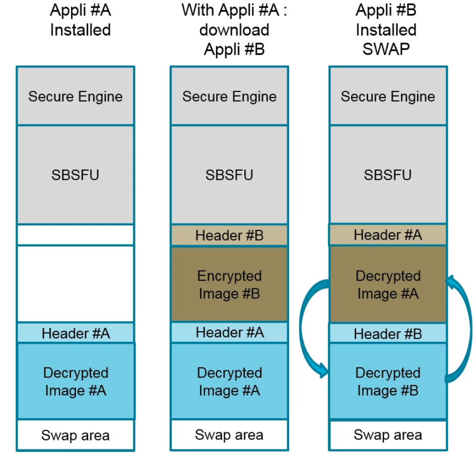
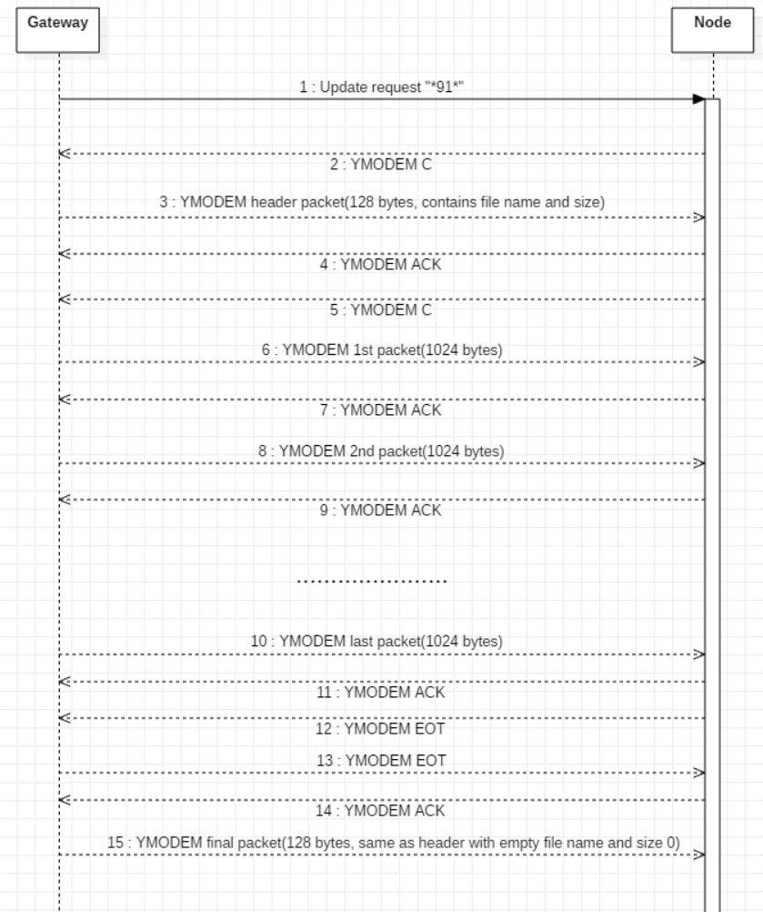
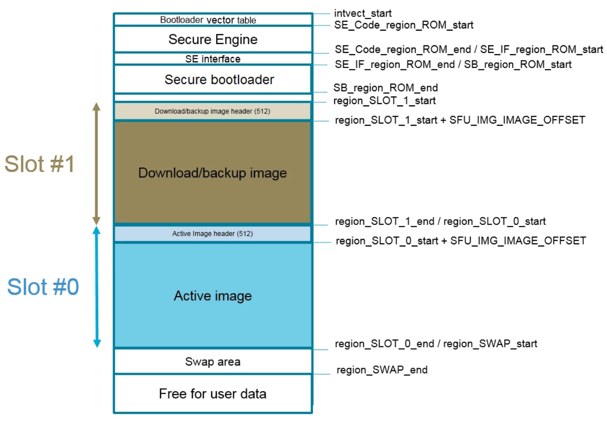

# FOTA - SBSFU Bootloader CubeMX Example Application

This application serves as an example of a minimal starting application that is compatible with the SBSFU bootloader.  
The application can be built as a standalone application or built to be used in combination with the SBSFU bootloader. For the application to work with the SBSFU bootloader, it has to be signed. More information about this can be found in the `Bootloader-FirmwareSigner` repo.

- [FOTA - SBSFU Bootloader CubeMX Example Application](#fota---sbsfu-bootloader-cubemx-example-application)
	- [Drivers](#drivers)
		- [Bootloader](#bootloader)
		- [OTAcomm](#otacomm)
		- [Third Party](#third-party)
			- [fw_update_app](#fw_update_app)
			- [Ymodem](#ymodem)
	- [Linker Scripts](#linker-scripts)
		- [STM32L496ZGTxP_FLASH.ld](#stm32l496zgtxp_flashld)
		- [STM32L496ZGTxP_FLASH_bootloader.ld](#stm32l496zgtxp_flash_bootloaderld)
		- [mapping_fwimg.ld](#mapping_fwimgld)
		- [mapping_sbsfu.ld](#mapping_sbsfuld)
	- [octa-stack integration](#octa-stack-integration)
		- [Makefiles](#makefiles)
			- [Application `Makefile`](#application-makefile)
			- [Usage of BOOTLOADER variable in `Makefile.core`](#usage-of-bootloader-variable-in-makefilecore)
			- [Usage of BOOTLOADER variable in the platform `Makefile`](#usage-of-bootloader-variable-in-the-platform-makefile)
		- [Mandatory bootloader implementation in the application](#mandatory-bootloader-implementation-in-the-application)
			- [Bootloader Functions](#bootloader-functions)
			- [Internal Watchdog Timer (IWDG)](#internal-watchdog-timer-iwdg)
  
## Drivers

Several drivers have to be included in the project for the application to work properly with the bootloader.

### Bootloader

The bootloader driver consists of:

- `void bootloader_SetVTOR(void)`: This function has to be called at the start of the main code. It moves the vector table to the correct memory offset of the application. Furthermore, it enables the IRQ, which is disabled by the bootloader before jumping to the application.

- `void bootloader_initialize(UART_HandleTypeDef* aUart)`: This function initializes the bootloader by setting an rx interrupt for the UART handle (e.g. BLE UART) passed to this function.

- `void bootloader_parse_data(void)`: The data parse function has to be called when data is received over the UART line. This function will compare this data to the *update_req* = \*91\* command. If the comparison checks out, the *FOTA_UpdateFirmware* function is called, starting the actual receiving of the new binary file.

- `bool bootloader_start_fw_update()`: This function inits the OTAcomm by passing the UART handle to it, as well as running the *FW_UPDATE_Run()* function. This function will start the actual state machine that will properly receive the binary file using the *Ymodem* protocol.

- `void LED_Toggle()`: Currently unused. Was put in OTAcomm by imec-NL but should not be there. Also should not be in the bootloader code but is put here for the moment ot not break ymodem code.

### OTAcomm

OTAcomm is the driver for the serial communication over which the actual firmware will be sent (e.g. UART of BLE).
The driver is as minimal as possible and only has 4 functions:

- `uint8_t OTAcomm_Init(UART_HandleTypeDef *uart)`: The init function sets the uart_handle used for the tx, rx and flush functions.

- `HAL_StatusTypeDef COM_Transmit(uint8_t *Data, uint16_t uDataLength, uint32_t uTimeout)`: The transmit function does a blocking UART transmit of the data passed to this function. Used by Ymodem.

- `HAL_StatusTypeDef COM_Receive(uint8_t *Data, uint16_t uDataLength, uint32_t uTimeout)`: This function does a blocking UART receive in the buffer passed to this function. Used by Ymodem.

- `HAL_StatusTypeDef COM_Flush()`: Flushes the COM UART. Used by Ymodem.

### Third Party

For the application to compile, the following folders have to be added under the *Drivers* folder:

- *SBSFU*: The actual firmware download code. The `bootloader.c/h` and `OTAcomm.c/h` are also stored here for convenience.

- *SECoreBin*: Low level crypto and CRC code, as well als metadata defines.
  
- *STM32_Cryptographic*: STM32 Crypto header files.

- *STM32_Secure_Engine*: The STM32 secure engine.

The two most important files are the `fw_update_app.c/h` and `ymodem.c/h` files. Both are located in the `SBSFU` folder. These are created by ST, with some minor tweaks done by imec-NL.

#### fw_update_app

In this file, the actual downloading of the code is performed. Several checks of the FW header and flash are performed.

- `FW_UPDATE_Run(void)`: This function, as previously mentioned, is called in *bootloader_start_fw_update()* and will start the actual FW update/download. It will perform some checks and download the new firmware image using the *FW_UPDATE_DownloadNewFirmware()* function. If this is successful, the *SFU_APP_InstallAtNextReset()* function is called, and the system is reset. After a reset, the actual bootloader code is ran which will now see that a new firmware file downloaded and will swap the current firmware with the newly downloaded one. This process is shown in the image below.
- `FW_UPDATE_DownloadNewFirmware(SFU_FwImageFlashTypeDef *pFwImageDwlArea)`: This function inits the Ymodem CRC by calling *Ymodem_Init()*, followed by the *Ymodem_Receive()* function.


*SBSFU Binary Swapping Process*

#### Ymodem

- `Ymodem_Init()`: Inits the *HAL_CRC* module, used by Ymodem.
- `Ymodem_Receive(uint32_t *puSize, uint32_t uFlashDestination)`: Receiving data using the Ymodem protocol with a CRC16. Has a switch case on the return status of the `ReceivePacket()` function.
- `ReceivePacket(uint8_t *pData, uint32_t *puLength, uint32_t uTimeout)`: The ReceivePacket function actually receives the packet from the sender using the `COM_Receive()` function.

The Ymodem flow is shown below.


*Ymodem communication flow*

## Linker Scripts

Some changes to the default linker script have to be made for the application to work in combination with the bootloader.

For reference, the dual slot memory layout of the SBSFU bootloader is shown in the figure below.


*SBSFU Dual Slot Memory Layout*

### STM32L496ZGTxP_FLASH.ld

This is the default linker script, thus starting the application image at *0x8000000* in the flash memory of the STM32 flash. This allows the application to still run as a standalone application if required.

### STM32L496ZGTxP_FLASH_bootloader.ld

This linker script takes the SBSFU dual slot memory layout into account, by including both `mapping_fwimg.ld` and `mapping_sbsfu.ld`.

### mapping_fwimg.ld

This linker script describes the mapping of the firmware image, by setting the *SLOT_0*, *SLOT_1* and *SWAP* start and end memory mappings.

### mapping_sbsfu.ld

This linker script descripes the mapping of all of the bootloader related memory regions.

## octa-stack integration

As described in the `README.md` of the stack, Makefiles are used to compile this project.

### Makefiles

#### Application `Makefile`

This application is currently being compiled for the *octa* platform.
The `BOOTLOADER` variable is used to indicate if the application should be compiled as a standalone binary, or as a binary to be used with the **SBSFU** bootloader.

```bash
# name of your application
APPLICATION = bootloader-minimal-example

# use the SBSFU bootloader
BOOTLOADER ?= 1

# platform for which the application will be built
PLATFORM ?= octa

# Path to the octa-stack base directory:
STACKBASE ?= ../..

include $(STACKBASE)/core/Makefile.core
```

Depending on this variable, the `Makefile.core` will include the correct sources, includes and linker scripts.

#### Usage of BOOTLOADER variable in `Makefile.core`

Using an `ifeq` statement in the `Makefile.core`, the *BOOTLOADER* variable of the application `Makefile` is checked.

A `BOOTLOADER_DEFINE` is set, and will be passed to the code on compilation. The target binary name is also changed to "aplication"-btl to create a distinction between the standalone an bootloader compatible binaries.

```bash
#######################################
# bootloader define
#######################################
ifeq ($(BOOTLOADER),1)
    BOOTLOADER_DEFINE = -DUSE_BOOTLOADER=1
    TARGET = $(APPLICATION)-btl
else
    BOOTLOADER_DEFINE = -DUSE_BOOTLOADER=0
    TARGET = $(APPLICATION)
endif
```

This define is passed along with the platform and shield defines to the code as follows:
  
```bash
# pass defines
$(BUILD_DIR)/%.o: %.c Makefile | $(BUILD_DIR) 
    $(CC) -c $(CFLAGS) $(PLATFORM_DEFINE) $(SHIELD_DEFINES) $(BOOTLOADER_DEFINE) ...
```

#### Usage of BOOTLOADER variable in the platform `Makefile`

In the platform's `Makefile.include` the sources are added to the `C_SOURCES` variable, e.g.:

```bash
ifeq ($(BOOTLOADER),1)
    C_SOURCES += $(ST_DIR)/SBSFU/Src/OTAcomm.c
    C_SOURCES += $(ST_DIR)/SBSFU/Src/bootloader.c
    C_SOURCES += $(ST_DIR)/SBSFU/Src/common.c
    C_SOURCES += $(ST_DIR)/SBSFU/Src/flash_if.c
    C_SOURCES += $(ST_DIR)/SBSFU/Src/fw_update_app.c
    C_SOURCES += $(ST_DIR)/SBSFU/Src/sfu_app_new_image.c
    C_SOURCES += $(ST_DIR)/SBSFU/Src/ymodem.c
endif
```

The correct linker script for standalone/bootloader is selected:

```bash
# link script
ifeq ($(BOOTLOADER),1)
LDSCRIPT = $(OCTA_DIR)/STM32L496ZGTxP_FLASH_bootloader.ld
else
LDSCRIPT = $(OCTA_DIR)/STM32L496ZGTxP_FLASH.ld
endif
```

### Mandatory bootloader implementation in the application

Obviously, the application source file needs to run the bootloader functions to be compatible with the bootloader, but it also needs to not use these when running as a standalone application. This is implemented by checking the **`USE_BOOTLOADER`** define that is passed to the code by the `Makefile.core` e.g.:

```c
#if USE_BOOTLOADER
  bootloader_SetVTOR();
#endif
```

#### Bootloader Functions

The required bootloader functions in the main code are:

- `bootloader_SetVTOR()`: This has to be called as soon as possible in the main code, as it will relocate the vector table.
- `bootloader_initialize(&uart_handle)`: This is called to initialize the bootloader. A uart_handle is passed to it, on which an rx interrupt will be set in this function.
- `bootloader_parse_data()`; While not necessarilly required in the main code, this function has to be called when the rx interrupt on the uart is fired. It will parse the serial data, and check for the **`*91*`** command.

#### Internal Watchdog Timer (IWDG)

Because the bootloader code starts the IWDG timer, this timer has to be refreshed in the code. If this is not properly done, the application resets, and reboots to the bootloader where an unwanted reset counter is kept. If this counter exceeds a specific number, the active firmware slot is destroyed. Furthermore, a rollback to the previous firmware version is performed. This rollback can only succeed if the version of the previous firmware is lower than the current firmware.

Feeding the watchdog timer is done as follows:

```c
//feed watchdog
WRITE_REG(IWDG->KR, IWDG_KEY_RELOAD);
```
